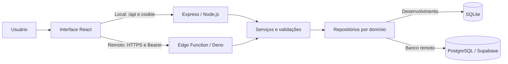
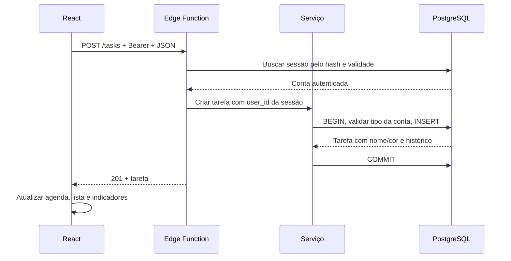

# Arquitetura da aplicação

## Visão geral

O sistema possui três domínios: autenticação, tarefas e tipos de tarefa. A interface
é React. As regras e a persistência ficam no backend, com dois adaptadores HTTP:
Express para execução local/servidor Node e Fetch para Supabase Edge Functions.

Há três formas implementadas de executar o código. A disponibilidade de código
não significa que o ambiente remoto já esteja publicado.

| Modo | Interface | API | Banco |
| --- | --- | --- | --- |
| Desenvolvimento local | Vite | Express | SQLite, sem `DATABASE_URL` |
| Servidor Node com banco remoto | Vite ou build servido pelo Express | Express | PostgreSQL, com `DATABASE_URL` |
| Arquitetura remota escolhida | Hospedagem estática separada | Supabase Edge Functions | PostgreSQL do Supabase |

O diagrama mostra os caminhos alternativos. Uma instância da API usa um banco de
cada vez; não há sincronização automática entre SQLite e PostgreSQL.

## Frontend: apresentação, regras e HTTP

| Camada | Localização | Responsabilidade |
| --- | --- | --- |
| Inicialização | `client/src/main.jsx`, `App.jsx` | Montar a aplicação |
| Autenticação | `domains/auth/AuthPage.jsx` | Cadastro, login e painel autenticado |
| Apresentação de tarefas | `domains/tasks/Dashboard.jsx`, `components/` | Agenda, filtros, lista e janela de cadastro |
| Desempenho | `domains/tasks/PerformanceDashboard.jsx` | Indicadores e gráficos |
| Coordenação de estado | `domains/tasks/hooks/useTasks.js` | Carregar e atualizar dados após operações da API |
| Regras locais | `domains/tasks/model/` | Datas, ordenação, ocorrências, combos e estatísticas |
| Tipos | `domains/task-types/TypeForm.jsx` | Cadastro de nome e cor |
| Integração de domínio | `api.js` em cada domínio | Operações HTTP daquele domínio |
| HTTP compartilhado | `shared/http/client.js` | URL base, JSON, cookie/token e erros |
| Componentes e estilos | `shared/components/`, `styles.css` | Modal, temas e apresentação responsiva |

Os caminhos abreviados acima estão em `client/src/`. O frontend calcula agenda e
indicadores a partir das tarefas da conta; a API continua responsável pela
validação e autorização das alterações.

`VITE_API_URL` é incorporada no build. Sem ela, as requisições usam `/api`, com
proxy do Vite para Express no desenvolvimento. Com a URL da função, o cliente
chama a API remota e envia a sessão em `Authorization: Bearer ...`.

## Backend: adaptadores e regras

| Camada | Localização em `server/` | Responsabilidade |
| --- | --- | --- |
| Inicialização Node | `index.js` | Ler `.env`, escolher banco, iniciar e encerrar servidor |
| Composição Express | `src/app.js` | Middleware, rotas, erros, health check e build opcional |
| Transporte Express | `src/domains/*/routes.js` | Traduzir requisições/respostas e identificar sessão por cookie |
| Transporte Edge | `src/edge/handler.js` | Request/Response, CORS, Bearer e rotas sem Express |
| Autenticação | `src/domains/auth/service.js` | Credenciais, hashes, tokens e sessões |
| Tarefas SQLite | `src/domains/tasks/service.js` | Validação e coordenação síncrona/transacional local |
| Tarefas PostgreSQL | `src/domains/tasks/postgres-service.js` | Coordenação assíncrona/transacional remota |
| Repositórios de domínio | `src/domains/*/repository.js` | Consultas SQLite ou seleção da implementação PostgreSQL |
| SQL PostgreSQL | `src/infrastructure/postgres-repositories.js` | Contas, sessões, tipos, tarefas e ocorrências no schema `tarefas` |
| Adaptador PostgreSQL | `src/infrastructure/postgres.js` | Pool, TLS e transação com conexão compartilhada |
| Infraestrutura SQLite | `src/infrastructure/database.js` | Arquivo, pragmas, tabelas e migrações de registros antigos |
| HTTP compartilhado | `src/shared/http.js` | Erros, autorização e propagação de falhas assíncronas |

A validação de tarefas é compartilhada. A coordenação transacional possui versões
SQLite e PostgreSQL; ao alterar esse fluxo, confira ambas para evitar divergência.
A validação de nome/cor dos tipos é compartilhada em `task-types/service.js`
pelos dois transportes HTTP.

## Empacotamento da Edge Function

`supabase/functions/tarefas-api/index.ts` inicia `Deno.serve`, abre PostgreSQL sob
demanda e fornece a implementação scrypt compatível com as senhas antigas.
`deno.json` declara dependências npm da função; `config.toml` configura seu deploy.

`npm run edge:prepare` copia uma lista explícita de módulos de `server/src/` para
`supabase/functions/_shared/backend/`. Esse diretório é gerado e ignorado pelo Git.
A função importa essa cópia; alterações no backend exigem preparar novamente antes
de publicar. Se um novo módulo passar a ser importado, atualize a lista do script.

## Autenticação e fronteiras de acesso

| Aspecto | Express | Edge Function |
| --- | --- | --- |
| Sessão enviada pelo navegador | Cookie HttpOnly, SameSite=Lax; Secure em produção | Bearer em cabeçalho, guardado no `sessionStorage` do frontend |
| Cadastro/login | Retorna usuário e define cookie | Retorna usuário e token |
| Expiração | Sete dias no banco | Sete dias no banco; o armazenamento local dura a aba |
| Limite de tentativas | Por IP, em memória do processo | Por hash do e-mail, persistido em `auth_attempts` |
| Origens | Uso previsto no mesmo domínio | Lista exata configurada em `ALLOWED_ORIGINS` |

Ambos armazenam somente o hash do token no banco e revogam a sessão no logout.
Senhas usam salt individual e scrypt. As contas são próprias da aplicação;
Supabase Auth não participa do fluxo.

O gateway JWT está desabilitado para a função porque o token da aplicação não é
um JWT do Supabase. O handler exige sessão válida antes de acessar tarefas/tipos.
CORS limita o uso pelo navegador, mas a autorização depende da sessão e das
consultas com `user_id`, inclusive para clientes que não sejam navegadores.

As tabelas PostgreSQL ficam em um schema privado, com RLS habilitada e sem
políticas para acesso direto pelo frontend. O backend conecta com privilégios de
servidor; nesse caminho, o isolamento por conta é aplicado explicitamente no SQL.
Não exponha credenciais administrativas ou o schema pela Data API.

## Fluxo de criação de tarefa remota

Datas e horários de prazo são representados como textos locais (`YYYY-MM-DD` e
`HH:mm`). A agenda não converte automaticamente esses campos para outro fuso.

## Modelo de dados

| Tabela | Conteúdo e relação |
| --- | --- |
| `users` | Conta, nome, e-mail único e hash da senha |
| `sessions` | Hash do token, usuário e expiração em milissegundos |
| `task_types` | Nome e cor por usuário |
| `tasks` | Definição, prioridade, data/horário, conclusão, usuário e tipo |
| `task_occurrences` | Conclusão/exceção por tarefa e data; chave composta |
| `auth_attempts` | Contador e expiração do limite de autenticação da Edge; somente PostgreSQL |

Uma diária possui uma definição em `tasks`. Apenas as conclusões e exceções são
persistidas por data; o frontend expande o intervalo necessário. Excluir a tarefa
remove as ocorrências por cascata. Tipos pertencem à conta, e a API verifica sua
propriedade antes de associá-los a uma tarefa.

SQLite atualiza a estrutura ao iniciar. PostgreSQL é preparado por SQL e scripts
explícitos. A importação preserva IDs, dados e hashes, mas não transfere sessões.
Tarefas antigas sem proprietário permanecem sem associação automática.

## Implantação e limites atuais

A arquitetura escolhida exige publicar o frontend estático e a função, aplicar o
schema, configurar secrets e informar a origem definitiva. O MCP ajuda a executar
a administração quando disponível; ele não faz parte do caminho de uma requisição.

O endpoint `/healthz` confirma o processo, sem verificar continuamente o banco.
Testes PGlite/Deno validam comportamento local; a conexão TLS e o fluxo no domínio
publicado ainda exigem verificação no ambiente real.

Consulte [ferramentas](tools.md), [estado da integração](migration-status.md) e
[procedimento Supabase](supabase.md) para comandos, evidências e pendências.
