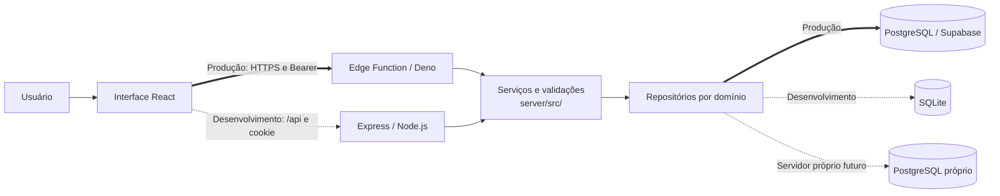
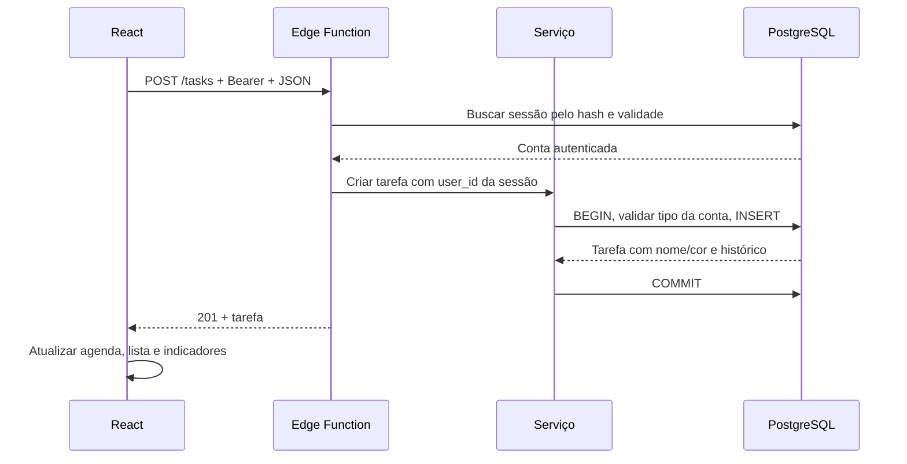

# Arquitetura da aplicação

## Visão geral

O sistema possui três domínios: autenticação, tarefas e tipos de tarefa. A interface
é React. As regras e a persistência ficam no backend, escrito uma vez em
`server/src/` e exposto por dois adaptadores HTTP: Fetch, para Supabase Edge
Functions, e Express, para Node.

## Papel de cada ambiente

| Ambiente | Papel | Interface | API | Banco |
| --- | --- | --- | --- | --- |
| **Produção** | **Principal** e único de uso real | Netlify (`<URL-do-frontend>`) | Supabase Edge Function `tarefas-api` | PostgreSQL do Supabase, schema `tarefas` |
| **Desenvolvimento** | Programar e testar localmente | Vite (`npm run dev`) | Express | SQLite em `server/tarefas.db` |
| **Servidor próprio** | **Segundo plano**: base para uma hospedagem futura, sem uso hoje | Build servido pelo Express | Express (Docker) | PostgreSQL, com `DATABASE_URL` |

Também é possível rodar o frontend local contra a produção (`npm run dev:remote`).
Esse modo não é um ambiente separado: lê e grava os dados reais.

As linhas grossas são o caminho de produção; as tracejadas, os caminhos locais e
futuros. Uma instância da API usa um banco de cada vez; não há sincronização
entre SQLite e PostgreSQL.

### Regras para manter os papéis

- **A referência é o caminho Edge + PostgreSQL.** Uma funcionalidade só está pronta
  quando funciona lá: migração SQL em `supabase/migrations/`, `edge:prepare` e
  publicação da função.
- **O Express + SQLite acompanha a produção, não o contrário.** Toda mudança de regra
  ou de schema precisa existir nos dois bancos (`postgres-service.js` e
  `postgres-repositories.js` de um lado; `service.js`, `repository.js` e
  `database.js` do outro). Os testes de `npm test` cobrem os dois.
- **Não crie recursos exclusivos do Express.** Algo que só exista no Express não chega
  à produção. Recursos específicos do Supabase (Auth, Storage, Realtime, cron)
  podem ser adotados, mas então o servidor próprio deixa de ser equivalente; nesse
  caso, registre a diferença aqui.
- **O SQLite é descartável.** Ele não guarda dados reais e pode ser apagado a
  qualquer momento.
- **Cada ambiente tem sua própria conexão.** Nenhuma variável é compartilhada
  entre a manutenção da produção e o Express, para que configurar uma não mude o
  banco da outra (veja a tabela abaixo).

### Conexões por ambiente

| Ambiente | Onde fica | Variável | Lida por |
| --- | --- | --- | --- |
| Produção, em execução | Secret da Edge Function | `TAREFAS_DATABASE_URL` (Transaction pooler) | `supabase/functions/tarefas-api/index.ts` |
| Produção, manutenção | `.env` da raiz | `SUPABASE_DATABASE_URL` (Session pooler) | Scripts `db:*`, via `server/scripts/supabase-env.js` |
| Desenvolvimento | `.env` da raiz | `DB_PATH` (padrão `server/tarefas.db`) | Express (`server/index.js`) |
| Servidor próprio | Ambiente do processo ou `.env` | `DATABASE_URL` | Express (`server/index.js`) |
| Frontend | Build do Vite | `VITE_API_URL` (vazia = Express local) | `client/src/shared/http/client.js` |

O Express escolhe o banco só por `DATABASE_URL`: vazia, usa o SQLite de `DB_PATH`;
preenchida, usa PostgreSQL e, fora de `NODE_ENV=production`, avisa no terminal.
Ele ignora `SUPABASE_DATABASE_URL`. Os scripts `db:*` fazem o inverso: só leem
`SUPABASE_DATABASE_URL` e recusam uma `DATABASE_URL` sozinha, pedindo a
renomeação. `PG_CA_PATH` é compartilhada, pois indica apenas o certificado.

## Frontend: apresentação, regras e HTTP

| Camada | Localização | Responsabilidade |
| --- | --- | --- |
| Inicialização | `client/src/main.jsx`, `App.jsx` | Montar a aplicação |
| Autenticação | `domains/auth/AuthPage.jsx` | Cadastro, login e painel autenticado |
| Apresentação de tarefas | `domains/tasks/Dashboard.jsx`, `components/` | Agenda, filtros, lista e janela de cadastro |
| Desempenho | `domains/tasks/PerformanceDashboard.jsx` | Indicadores e gráficos |
| Coordenação de estado | `domains/tasks/hooks/useTasks.js` | Carregar e atualizar dados após operações da API |
| Regras locais | `domains/tasks/model/` | Datas, ordenação, ocorrências, combos e estatísticas |
| Tipos | `domains/task-types/` | Cadastro e personalização de nome, cor e ícone (`TypeForm`, `TypeManager`, `IconPicker`, `icons.jsx`) |
| Integração de domínio | `api.js` em cada domínio | Operações HTTP daquele domínio |
| HTTP compartilhado | `shared/http/client.js` | URL base, JSON, cookie/token e erros |
| Componentes e estilos | `shared/components/`, `styles.css` | Modal, logo, temas e apresentação responsiva |

O logo do nextOrganize existe em dois lugares que devem ficar iguais:
`client/public/favicon.svg` (ícone da aba) e `shared/components/Logo.jsx`
(`LogoMark` na barra lateral e no carregamento; `Logo`, com o nome, no login).

Os caminhos abreviados acima estão em `client/src/`. O frontend calcula agenda e
indicadores a partir das tarefas da conta; a API continua responsável pela
validação e autorização das alterações.

`VITE_API_URL` é incorporada no build. Na produção, aponta para a função, e o
cliente envia a sessão em `Authorization: Bearer ...`. Vazia, as requisições usam
`/api`, com proxy do Vite para o Express local e sessão por cookie.

## Backend: adaptadores e regras

| Camada | Localização em `server/` | Responsabilidade |
| --- | --- | --- |
A coluna **Uso** indica onde cada módulo roda: **Produção** (copiado para a Edge
por `edge:prepare`), **Local** (só Express/SQLite) ou **Ambos**.

| Camada | Localização em `server/` | Uso | Responsabilidade |
| --- | --- | --- | --- |
| Transporte Edge | `src/edge/handler.js` | Produção | Request/Response, CORS, Bearer e rotas sem Express |
| Autenticação | `src/domains/auth/service.js` | Ambos | Credenciais, hashes, tokens e sessões |
| Tarefas | `src/domains/tasks/service.js` | Ambos | Validação compartilhada; seleciona a versão PostgreSQL ou coordena o SQLite |
| Tarefas PostgreSQL | `src/domains/tasks/postgres-service.js` | Produção | Coordenação assíncrona/transacional |
| Validação de datas | `src/domains/tasks/validation.js` | Ambos | Datas reais e limites das ocorrências |
| Tipos | `src/domains/task-types/service.js` | Ambos | Validação de nome, cor e ícone |
| Repositórios de domínio | `src/domains/*/repository.js` | Ambos | Consultas SQLite ou seleção da implementação PostgreSQL |
| SQL PostgreSQL | `src/infrastructure/postgres-repositories.js` | Produção | Contas, sessões, tipos, tarefas e ocorrências no schema `tarefas` |
| Adaptador PostgreSQL | `src/infrastructure/postgres.js` | Produção | Pool, TLS e transação com conexão compartilhada |
| HTTP compartilhado | `src/shared/http.js` | Ambos | Erros, autorização e propagação de falhas assíncronas |
| Inicialização Node | `index.js` | Local | Ler `.env`, escolher banco, iniciar e encerrar servidor |
| Composição Express | `src/app.js` | Local | Middleware, rotas, erros, health check e build opcional |
| Transporte Express | `src/domains/*/routes.js` | Local | Traduzir requisições/respostas e identificar sessão por cookie |
| Infraestrutura SQLite | `src/infrastructure/database.js` | Local | Arquivo, pragmas, tabelas e migrações de registros antigos |

Os módulos marcados **Produção** também servem ao Express quando ele usa
PostgreSQL (modo servidor próprio).

A validação de tarefas é compartilhada. A coordenação transacional possui versões
SQLite e PostgreSQL; ao alterar esse fluxo, confira ambas para evitar divergência.
A validação de nome/cor dos tipos é compartilhada em `task-types/service.js`
pelos dois transportes HTTP.

## Empacotamento da Edge Function

`supabase/functions/tarefas-api/index.ts` inicia `Deno.serve`, abre PostgreSQL sob
demanda e fornece a implementação scrypt compatível com as senhas antigas.
`deno.json` declara dependências npm da função; `config.toml` configura seu deploy.

`npm run edge:prepare` copia uma lista explícita de módulos de `server/src/` para
`supabase/functions/_shared/backend/`. Esse diretório é gerado e ignorado pelo Git.
A função importa essa cópia; alterações no backend exigem preparar novamente antes
de publicar. Se um novo módulo passar a ser importado, atualize a lista do script.

## Autenticação e fronteiras de acesso

| Aspecto | Edge Function (produção) | Express (local / servidor próprio) |
| --- | --- | --- |
| Sessão enviada pelo navegador | Bearer em cabeçalho, guardado no `sessionStorage` do frontend | Cookie HttpOnly, SameSite=Lax; Secure com `NODE_ENV=production` |
| Cadastro/login | Retorna usuário e token | Retorna usuário e define cookie |
| Expiração | Sete dias no banco; o armazenamento local dura a aba | Sete dias no banco |
| Limite de tentativas | Por hash do e-mail, persistido em `auth_attempts` | Por IP, em memória do processo |
| Origens | Lista exata configurada em `ALLOWED_ORIGINS` | Mesmo domínio (proxy do Vite ou build servido pelo Express) |

Ambos armazenam somente o hash do token no banco e revogam a sessão no logout.
Senhas usam salt individual e scrypt. As contas são próprias da aplicação;
Supabase Auth não participa do fluxo.

O gateway JWT está desabilitado para a função porque o token da aplicação não é
um JWT do Supabase. O handler exige sessão válida antes de acessar tarefas/tipos.
CORS limita o uso pelo navegador, mas a autorização depende da sessão e das
consultas com `user_id`, inclusive para clientes que não sejam navegadores.

As tabelas PostgreSQL ficam em um schema privado, com RLS habilitada e sem
políticas para acesso direto pelo frontend. O backend conecta com privilégios de
servidor; nesse caminho, o isolamento por conta é aplicado explicitamente no SQL.
Não exponha credenciais administrativas ou o schema pela Data API.

## Fluxo de criação de tarefa remota

Datas e horários de prazo são representados como textos locais (`YYYY-MM-DD` e
`HH:mm`). A agenda não converte automaticamente esses campos para outro fuso.

## Modelo de dados

| Tabela | Conteúdo e relação |
| --- | --- |
| `users` | Conta, nome, e-mail único e hash da senha |
| `sessions` | Hash do token, usuário e expiração em milissegundos |
| `task_types` | Nome, cor e ícone opcional por usuário |
| `tasks` | Definição, prioridade, data/horário, repetição (`recurrence`, `recurrence_days`, `recurrence_until`), conclusão, usuário e tipo |
| `task_occurrences` | Conclusão/exceção por tarefa e data; chave composta |
| `auth_attempts` | Contador e expiração do limite de autenticação da Edge; somente PostgreSQL |

Uma tarefa periódica (diária ou semanal) possui uma definição em `tasks`. Apenas as conclusões e exceções são
persistidas por data; o frontend expande o intervalo necessário. Excluir a tarefa
remove as ocorrências por cascata. Tipos pertencem à conta, e a API verifica sua
propriedade antes de associá-los a uma tarefa.

O schema de referência é o PostgreSQL, definido pelos arquivos de
`supabase/migrations/` e aplicado por `npm run db:schema:supabase`. O SQLite
espelha essa estrutura em `infrastructure/database.js`, que a atualiza ao iniciar.
A importação SQLite → PostgreSQL (`db:migrate:supabase`) foi usada uma vez, na
mudança para o Supabase; preserva IDs, dados e hashes, mas não transfere sessões.

## Fluxo de uma mudança no backend

1. Implemente a regra em `server/src/` e teste com `npm run dev` (SQLite).
2. Se mudar o schema, crie um novo arquivo em `supabase/migrations/` e reproduza a
   alteração em `infrastructure/database.js`.
3. Atualize as duas implementações de persistência quando a mudança tocar SQL, e
   rode `npm test`, que cobre SQLite e PostgreSQL (PGlite).
4. Se um novo módulo for importado pela Edge, inclua-o em
   `server/scripts/prepare-edge.js`.
5. Na `main`, aplique a migração (`npm run db:schema:supabase`, com
   `SUPABASE_DATABASE_URL` no `.env`), rode `npm run edge:prepare` e publique a
   função. Veja [Supabase: produção](supabase.md).

## Implantação e limites atuais

A produção exige publicar o frontend estático e a função, aplicar o schema,
configurar secrets e manter a origem do frontend em `ALLOWED_ORIGINS`. O MCP ajuda
a executar a administração quando disponível; ele não faz parte do caminho de uma
requisição. O modo servidor próprio não tem implantação ativa.

O endpoint `/healthz` confirma o processo, sem verificar continuamente o banco.
Testes PGlite/Deno validam comportamento local. A conexão TLS e o fluxo remoto
foram verificados por HTTP em 18/11/2026; mudanças futuras exigem nova conferência
no ambiente real.

Consulte [ferramentas](ferramentas.md), [estado da integração](estado-supabase.md) e
[procedimento Supabase](supabase.md) para comandos, evidências e pendências.
